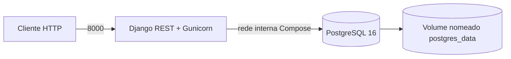

# Portal Cidadão Seguro

- **Código da disciplina:** IBM8936
- **Integrantes informados:** Caio Domingues, Keanu Santos, Bernardo Meireles e Eric Lerer

## Arquitetura de deploy



O PostgreSQL não publica portas no host. Em produção, o Security Group da EC2 deve permitir SSH (22) somente a partir do IP administrativo e a porta 8000 para os clientes da API; não deve haver regra para a porta 5432.

## Execução local

Pré-requisitos: Docker Engine e Docker Compose v2.

```bash
cp .env.example .env
```

Edite `.env` e substitua `SECRET_KEY` e `POSTGRES_PASSWORD` por valores próprios. Não versione esse arquivo. Em seguida:

```bash
docker compose up -d --build
docker compose ps
docker compose logs -f web
curl http://localhost:8000/api/
```

O container `web` executa migrations e `collectstatic` antes de iniciar o Gunicorn. Para criar o administrador:

```bash
docker compose exec web python manage.py createsuperuser
```

Admin local: <http://localhost:8000/admin/>.
Admin EC2: <http://3.12.84.130:8000/admin/>

## Deploy em EC2 Ubuntu

1. Crie uma EC2 Ubuntu e configure o Security Group para liberar SSH (22) apenas para seu IP e TCP 8000 para os clientes. Não abra 5432.
2. Instale Docker, Compose v2 e Git na instância:

	```bash
	sudo apt update
	sudo apt install -y docker.io docker-compose-v2 git
	sudo systemctl enable --now docker
	sudo usermod -aG docker "$USER"
	```

	Encerre e reabra a sessão SSH para aplicar o grupo `docker`.
3. Clone o repositório, crie o `.env` a partir do exemplo e configure valores fortes, além do IP/DNS público da instância em `ALLOWED_HOSTS`:

	```bash
	git clone <URL_DO_REPOSITORIO>
	cd <DIRETORIO_DO_REPOSITORIO>
	cp .env.example .env
	nano .env
	```

	Gere uma chave Django com `openssl rand -base64 48`. Nunca envie `.env` ao Git.
4. Publique a aplicação:

	```bash
	git pull
	docker compose up -d --build
	docker compose ps
	docker compose logs --tail=100 web
	```

	Migrations e arquivos estáticos são atualizados na inicialização do container. Crie o superusuário uma vez com `docker compose exec web python manage.py createsuperuser`.
5. Valide de fora da instância, substituindo pelo IP público:

	```bash
	curl http://IP_PUBLICO_EC2:8000/api/
	```

	Admin: `http://IP_PUBLICO_EC2:8000/admin/`.

## Verificação de persistência e evidências

O volume nomeado `postgres_data` sobrevive a `docker compose down`; não use `docker compose down -v`, pois `-v` remove os dados. Para comprovar a persistência do volume durante a demonstração, crie um registro de verificação:

```bash
docker compose exec db sh -lc 'psql -U "$POSTGRES_USER" -d "$POSTGRES_DB" -c "CREATE TABLE IF NOT EXISTS ap2_persistence_check (id integer PRIMARY KEY); INSERT INTO ap2_persistence_check VALUES (1) ON CONFLICT DO NOTHING;"'
docker compose down
docker compose up -d
docker compose exec db sh -lc 'psql -U "$POSTGRES_USER" -d "$POSTGRES_DB" -c "SELECT * FROM ap2_persistence_check;"'
```

Guarde evidências de `docker compose ps`, `docker compose logs`, resposta da API e consulta no `psql` para anexar à entrega. A API deste bootstrap ainda não contém os recursos de negócio, models ou dados seed do domínio.

## Links da entrega

- API publicada: preencher após criar e validar a EC2 (`http://IP_PUBLICO_EC2:8000/api/`).
- Site MkDocs: publicação ainda precisa ser confirmada e vinculada aqui.

