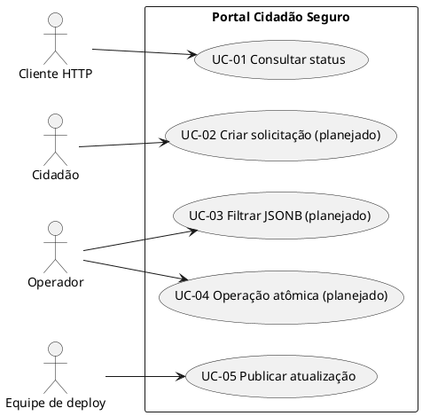

# Casos de Uso Arquiteturais

## Controle do documento

| Campo | Informação |
|---|---|
| Projeto | Portal Cidadão Seguro |
| Versão | 2.0 — revisão documental AP2 |
| Data | 11/11/2026 |
| Aprovação | Pendente de validação pelo grupo |

> **Situação:** este documento distingue arquitetura verificada no repositório de requisitos ainda não implementados ou não comprovados. Não constitui evidência de deploy em produção.

## Casos de uso relevantes
| ID | Caso de uso | Ator | Relevância | Situação |
|---|---|---|---|---|
| UC-01 | Consultar status da API | Cliente HTTP | Verificar serviço Django | Implementado em `/api/` |
| UC-02 | Criar solicitação cidadã | Cidadão | Exige modelos e validações | Planejado; não encontrado |
| UC-03 | Consultar solicitações por atributo JSONB | Operador | Exige JSONField, GIN e filtro | Planejado; não encontrado |
| UC-04 | Registrar operação transacional | Operador | Exige `transaction.atomic()` e rollback | Planejado; não encontrado |
| UC-05 | Publicar atualização | Equipe de deploy | Integra Git, Docker e banco | Procedimento documentado; execução não comprovada |

## Diagrama de casos de uso (PlantUML)

## Rastreabilidade
| Requisito | Caso | Componente | Teste/evidência |
|---|---|---|---|
| B6 | UC-01 | `config/urls.py` | GET `/api/`; acesso público pendente |
| A2, A5 | UC-02 | App de domínio a implementar | CRUD e testes pendentes |
| A3, A5 | UC-03 | JSONField, índice GIN, filtro a implementar | Teste de filtro pendente |
| A4 | UC-04 | Serviço transacional a implementar | Teste de rollback pendente |
| B2, B5 | UC-05 | Docker Compose e EC2 | Compose presente; logs da EC2 pendentes |
