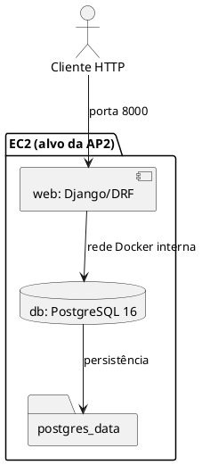

# Modelo de Análise — Pacotes e Subsistemas

## Controle do documento

| Campo | Informação |
|---|---|
| Projeto | Portal Cidadão Seguro |
| Versão | 2.0 — revisão documental AP2 |
| Data | 11/11/2026 |
| Aprovação | Pendente de validação pelo grupo |

> **Situação:** este documento distingue arquitetura verificada no repositório de requisitos ainda não implementados ou não comprovados. Não constitui evidência de deploy em produção.

## Pacotes reais identificados
- `config/`: configurações, URLs e WSGI do Django.
- Django REST Framework: API HTTP; no código entregue, apenas endpoint de status.
- `db`: serviço PostgreSQL 16 Alpine no Docker Compose.
- `web`: serviço Django com Gunicorn, conforme README e configuração Docker.
- `postgres_data`: volume nomeado para persistência do PostgreSQL.
- Segurança: variáveis de ambiente e `.env.example`; regras efetivas da EC2 ainda não comprovadas.

## Diagrama de componentes

## Dependências
O serviço `web` depende do healthcheck do `db`; a aplicação usa variáveis `POSTGRES_*` para conexão. Não foram encontrados apps de domínio com models de negócio, nem componentes JSONB/GIN.

## Matriz de rastreabilidade
| Requisito | Pacote | Evidência |
|---|---|---|
| B2 | `docker-compose.yml` | `web`, `db`, `depends_on`, healthcheck e volume |
| A7/B4 | `config/settings.py`, `.env.example` | Leitura de segredos do ambiente |
| A2/A3/A4/A5 | App de domínio | Não encontrado; desenvolvimento pendente |
| B6 | `config/urls.py` | `/api/` e `/admin/`; acesso EC2 não comprovado |
