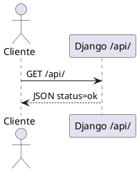
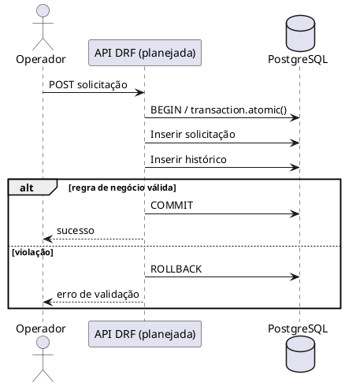

# Diagramas de Sequência e Comunicação

## Controle do documento

| Campo | Informação |
|---|---|
| Projeto | Portal Cidadão Seguro |
| Versão | 2.0 — revisão documental AP2 |
| Data | 11/11/2026 |
| Aprovação | Pendente de validação pelo grupo |

> **Situação:** este documento distingue arquitetura verificada no repositório de requisitos ainda não implementados ou não comprovados. Não constitui evidência de deploy em produção.

## Fluxo implementado: consulta de status

## Fluxo planejado: criação transacional
**Não implementado no código enviado.** O fluxo abaixo é uma especificação-alvo para A4, não uma comprovação.

## Fluxo planejado: consulta JSONB
Cliente → endpoint DRF com filtro `atributos__chave` → consulta PostgreSQL JSONB → resposta JSON. Requer model, migration GIN, filtro e teste ainda não encontrados.

## Fluxo de deploy descrito no README
Windows → `git push` → EC2 `git pull` → `docker compose up -d --build` → migrations/collectstatic → teste HTTP. A execução real não foi comprovada no ZIP.

## Matriz de rastreamento
| Requisito | Fluxo | Componente | Teste/evidência |
|---|---|---|---|
| B6 | Status | `config/urls.py` | GET `/api/`; IP público pendente |
| A4 | Criação transacional | API e models a implementar | Teste rollback pendente |
| A3/A5 | Consulta JSONB | Model e filtro a implementar | Teste filtro pendente |
| B5 | Deploy | Compose, EC2 | Logs/prints pendentes |
