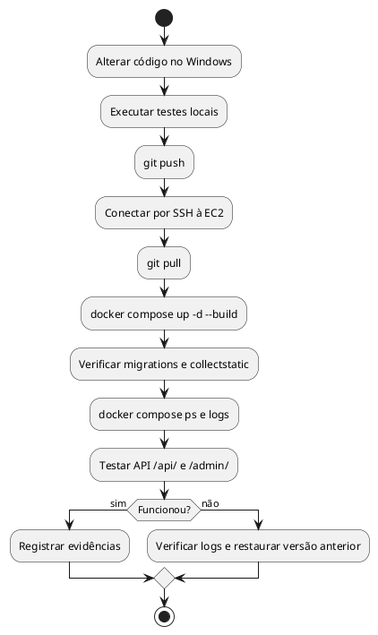

# Estratégias de Deploy e Atividades

## Controle do documento

| Campo | Informação |
|---|---|
| Projeto | Portal Cidadão Seguro |
| Versão | 2.0 — revisão documental AP2 |
| Data | 11/11/2026 |
| Aprovação | Pendente de validação pelo grupo |

> **Situação:** este documento distingue arquitetura verificada no repositório de requisitos ainda não implementados ou não comprovados. Não constitui evidência de deploy em produção.

## Alternativas avaliadas
| Estratégia | Vantagem | Limitação | Decisão |
|---|---|---|---|
| Elastic Beanstalk + SQLite | Simplicidade inicial | Não atende arquitetura AP2 | Não escolhida |
| EC2 + Docker Compose + PostgreSQL | Controle dos containers e persistência | Equipe administra host e backup | **Escolhida para AP2** |
| EC2 + RDS | Banco gerenciado | Banco não estaria no container exigido | Não escolhida |
| ECS + RDS | Orquestração e gestão de serviços | Maior complexidade e divergência da AP2 | Não escolhida |

## Diagrama de atividades do deploy (procedimento documentado)

## Estimativas de tempo e custo
**Estimativa de planejamento, não medição:** reservar 30–90 minutos para configuração e validação inicial, dependendo de permissões, instalação e falhas. Custo mensal = horas de EC2 × tarifa regional + EBS + tráfego e outros recursos aplicáveis. Preencher valores somente após confirmar instância, região e tabela oficial de preços.

## Plano de rollback
1. Registrar commit anterior estável e fazer backup consistente do banco antes de migrações potencialmente destrutivas.
2. Se o deploy falhar, verificar logs e restaurar a versão anterior do código/imagem.
3. Se houver mudança incompatível de esquema, seguir procedimento testado de restauração do backup; voltar o código sozinho pode não bastar.
4. Validar `/api/`, `/admin/` e integridade dos dados.

## Evidências pendentes
IP e URL públicos reais, `docker compose ps`, logs, consulta `psql`, teste de persistência, tempo efetivo e custo real.
